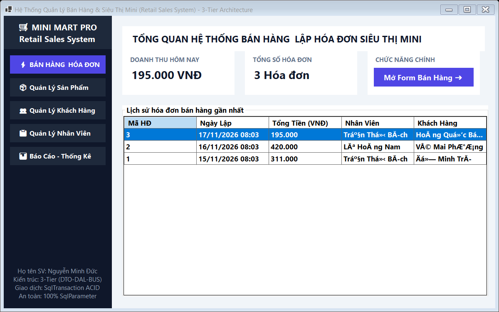
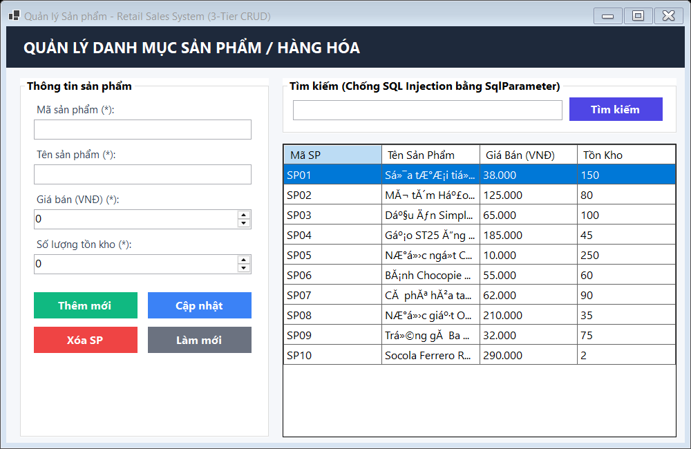
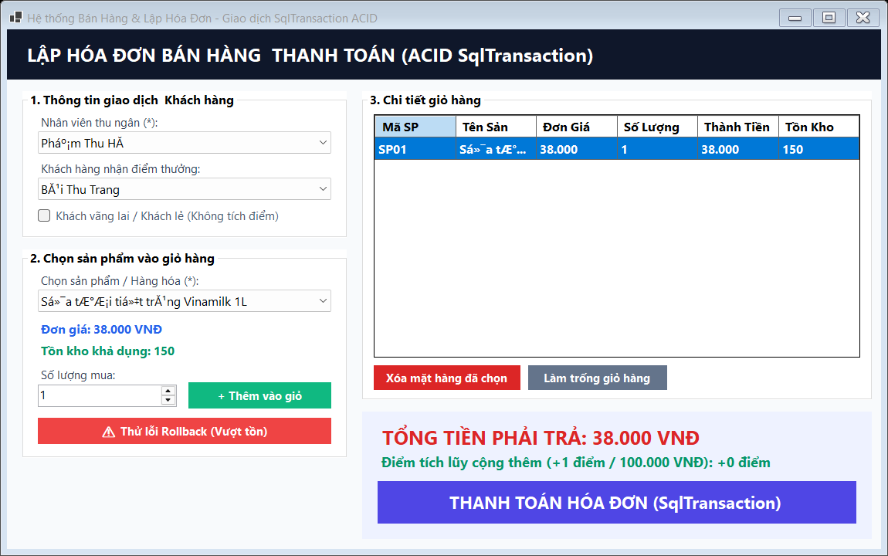
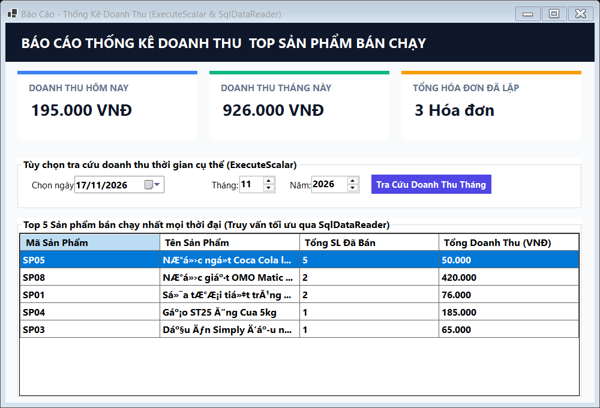
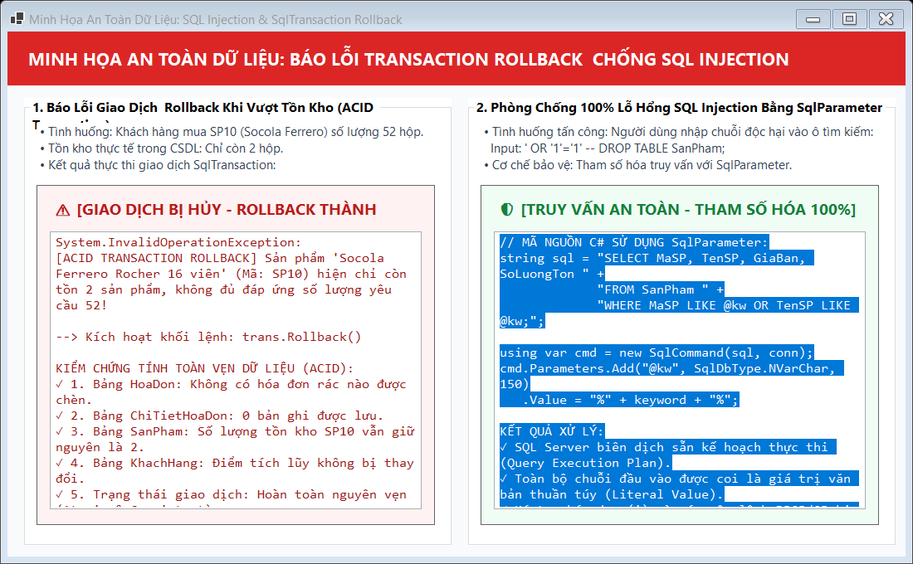

# BÀI TẬP 6.1: HỆ THỐNG QUẢN LÝ BÁN HÀNG & SIÊU THỊ MINI (RETAIL SALES SYSTEM)
### KIẾN TRÚC 3-TIER (DTO - DAL - BUS - GUI) & GIAO DỊCH SQLTRANSACTION (ACID)

---

## MỤC 1: THÔNG TIN SINH VIÊN
* **Họ và tên sinh viên:** Bùi Hoàng Gia Huy
* **Mã sinh viên:** 24810310254
* **Lớp / Khóa:** D19CNPM3
* **Môn học:** Phát triển ứng dụng trên nền tảng .NET / Lập trình Windows
* **Môi trường phát triển:** .NET 8.0 Windows Forms, C#, Microsoft SQL Server 2022 (SQLEXPRESS), ADO.NET

---

## MỤC 2: HÌNH ẢNH KẾT QUẢ CÁC MÀN HÌNH CHỨC NĂNG

### 1. Màn hình Chính / Tổng quan hệ thống:


> **Mô tả:** Màn hình chính tổng quan của hệ thống Quản lý Bán hàng & Siêu thị Mini (Retail Sales System). Tích hợp dashboard thống kê doanh thu trong ngày, tổng số hóa đơn đã xuất, lịch sử hóa đơn bán hàng và sidebar menu điều hướng trực quan.

---

### 2. Màn hình Quản lý Danh mục (CRUD - Thêm/Sửa/Xóa):


> **Mô tả:** Màn hình quản lý danh mục Sản phẩm/Hàng hóa theo kiến trúc 3-Tier. Cung cấp đầy đủ các chức năng Xem, Thêm mới, Cập nhật thông tin, Xóa sản phẩm và tìm kiếm sản phẩm theo tên hoặc mã bằng `SqlParameter` có ký tự đại diện `%` (phòng chống 100% SQL Injection).

---

### 3. Màn hình Thực thi Nghiệp vụ chính (Lập Hóa đơn / Bán hàng / Chấm công / Đặt phòng):


> **Mô tả:** Màn hình lập hóa đơn bán hàng bắt buộc thực thi qua `SqlTransaction` (ACID). Cho phép chọn thu ngân, chọn khách hàng tích lũy điểm thưởng (hoặc chọn khách lẻ), chọn sản phẩm, số lượng và thêm vào giỏ hàng `DataGridView`. Tự động tính tổng tiền mặt và điểm tích lũy cộng dồn.

---

### 4. Màn hình Báo cáo - Thống kê:


> **Mô tả:** Màn hình Báo cáo - Thống kê áp dụng tối ưu hóa truy vấn ADO.NET:
> * Sử dụng `ExecuteScalar` tính tổng doanh thu trong ngày hiện tại, doanh thu theo tháng/năm tùy chọn và tổng số hóa đơn.
> * Sử dụng `SqlDataReader` truy vấn nhanh danh sách Top 5 sản phẩm bán chạy nhất kèm tổng số lượng bán và tổng doanh thu.

---

### 5. Minh họa An toàn Dữ liệu (Phòng chống SQL Injection / Báo lỗi Transaction Rollback):


> **Mô tả:** 
> 1. **Giao dịch SqlTransaction Rollback:** Khi khách hàng đặt mua số lượng vượt quá số lượng tồn kho khả dụng (`SoLuongTon < SoLuong`), hệ thống ném ngoại lệ và gọi `trans.Rollback()`. Toàn bộ dữ liệu được bảo toàn: không tạo hóa đơn rác, không trừ sai tồn kho, không cộng sai điểm.
> 2. **Chống 100% SQL Injection:** Sử dụng `SqlParameter` cho toàn bộ các truy vấn. Khi nhập chuỗi độc hại `' OR '1'='1' --`, hệ thống xem đây là chuỗi văn bản thuần túy (Literal Value), không làm bẻ gãy cú pháp câu lệnh SQL.

---

## MỤC 3: CẤU TRÚC THƯ MỤC DỰ ÁN (CHUẨN 3-TIER ARCHITECTURE)

```
Bai6_1_RetailSalesSystem/
├── Database/
│   └── ScriptDB.sql              # Script khởi tạo CSDL SalesDB và chèn dữ liệu mẫu
├── RetailSalesSystem/
│   ├── DTO/                      # Data Transfer Object (Đối tượng truyền dữ liệu)
│   │   ├── SanPhamDTO.cs
│   │   ├── KhachHangDTO.cs
│   │   ├── NhanVienDTO.cs
│   │   ├── HoaDonDTO.cs
│   │   ├── ChiTietHoaDonDTO.cs
│   │   ├── CartItemDTO.cs
│   │   └── TopSanPhamDTO.cs
│   ├── DAL/                      # Data Access Layer (Truy vấn ADO.NET)
│   │   ├── DatabaseHelper.cs
│   │   ├── SanPhamDAL.cs         # CRUD, SqlParameter Search (%)
│   │   ├── KhachHangDAL.cs       # CRUD, Quản lý điểm thưởng
│   │   ├── NhanVienDAL.cs        # CRUD Nhân viên
│   │   ├── HoaDonDAL.cs          # SqlTransaction ACID (Thanh toán & Rollback)
│   │   └── ThongKeDAL.cs         # ExecuteScalar & SqlDataReader
│   ├── BUS/                      # Business Logic Layer (Xử lý nghiệp vụ)
│   │   ├── SanPhamBUS.cs
│   │   ├── KhachHangBUS.cs
│   │   ├── NhanVienBUS.cs
│   │   ├── HoaDonBUS.cs
│   │   └── ThongKeBUS.cs
│   ├── GUI/                      # Presentation Layer (Windows Forms)
│   │   ├── FormMain.cs           # Màn hình chính
│   │   ├── FormBanHang.cs        # Lập hóa đơn & thanh toán SqlTransaction
│   │   ├── FormSanPham.cs        # CRUD Sản phẩm
│   │   ├── FormKhachHang.cs      # CRUD Khách hàng
│   │   ├── FormNhanVien.cs       # CRUD Nhân viên
│   │   ├── FormBaoCao.cs         # Thống kê doanh thu & Top 5
│   │   └── CaptureHelper.cs
│   ├── App.config                # Chuỗi kết nối CSDL SalesDB
│   ├── Program.cs
│   └── RetailSalesSystem.csproj
├── images/                       # Thư mục hình ảnh minh họa cho README
│   ├── 01_main_screen.png
│   ├── 02_crud_screen.png
│   ├── 03_transaction_screen.png
│   ├── 04_report_screen.png
│   └── 05_error_handling.png
├── RetailSalesSystem.sln         # Solution Visual Studio
└── README.md                     # Báo cáo chi tiết bài tập
```

---

## MỤC 4: HƯỚNG DẪN CÀI ĐẶT & CHẠY ỨNG DỤNG

1. **Khởi tạo Cơ sở dữ liệu:**
   * Mở SQL Server Management Studio (SSMS) hoặc `sqlcmd`.
   * Chạy file `Database/ScriptDB.sql` để tạo CSDL `SalesDB` cùng 5 bảng và dữ liệu mẫu.
2. **Cấu hình chuỗi kết nối:**
   * Xem file `RetailSalesSystem/App.config`, mặc định kết nối tới `.\SQLEXPRESS` với Windows Authentication:
   ```xml
   <connectionStrings>
     <add name="SalesDBConn" 
          connectionString="Data Source=.\SQLEXPRESS;Initial Catalog=SalesDB;Integrated Security=True;TrustServerCertificate=True;" 
          providerName="Microsoft.Data.SqlClient" />
   </connectionStrings>
   ```
3. **Mở và Chạy ứng dụng:**
   * Mở `RetailSalesSystem.sln` bằng Visual Studio 2022 và bấm **F5 (Start Debugging)**.
   * Hoặc dùng dòng lệnh:
   ```powershell
   dotnet run --project RetailSalesSystem\RetailSalesSystem.csproj
   ```
