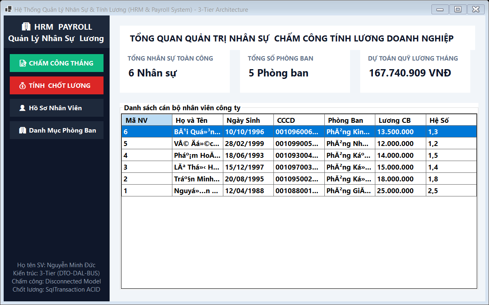
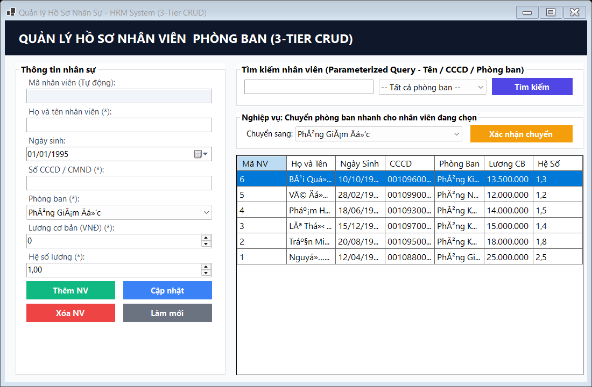
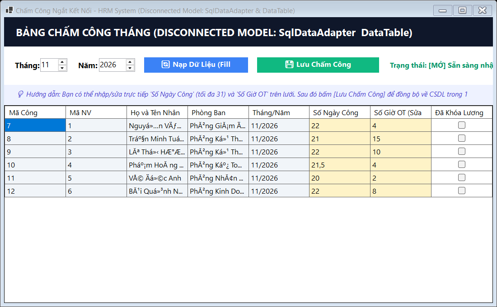
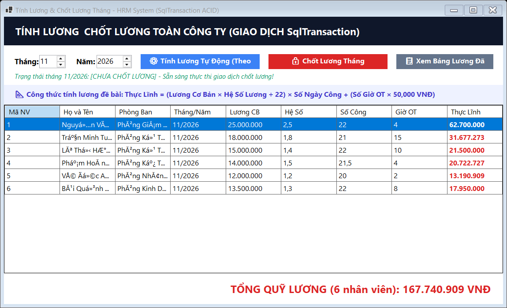
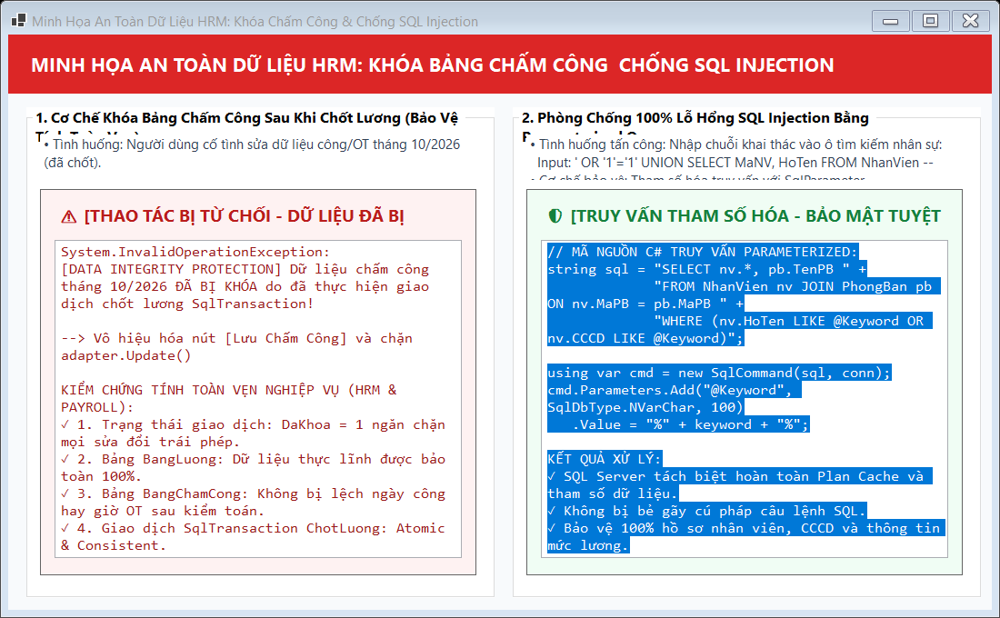

# BÀI TẬP 6.2: HỆ THỐNG QUẢN LÝ NHÂN SỰ & TÍNH LƯƠNG (HRM & PAYROLL SYSTEM)
### KIẾN TRÚC 3-TIER, MÔ HÌNH NGẮT KẾT NỐI (DISCONNECTED MODEL) & GIAO DỊCH SQLTRANSACTION

---

## MỤC 1: THÔNG TIN SINH VIÊN
* **Họ và tên sinh viên:** Bùi Hoàng Gia Huy
* **Mã sinh viên:** 24810310254
* **Lớp / Khóa:** D19CNPM3
* **Môn học:** Phát triển ứng dụng trên nền tảng .NET / Lập trình Windows
* **Môi trường phát triển:** .NET 8.0 Windows Forms, C#, Microsoft SQL Server 2022 (SQLEXPRESS), ADO.NET

---

## MỤC 2: HÌNH ẢNH KẾT QUẢ CÁC MÀN HÌNH CHỨC NĂNG

### 1. Màn hình Chính / Tổng quan hệ thống:


> **Mô tả:** Màn hình chính tổng quan của hệ thống Quản lý Nhân sự & Tính lương (HRM & Payroll System). Tích hợp dashboard thống kê tổng nhân sự, số lượng phòng ban, dự toán quỹ lương và menu điều hướng sidebar chuyên nghiệp.

---

### 2. Màn hình Quản lý Danh mục (CRUD - Thêm/Sửa/Xóa):


> **Mô tả:** Màn hình quản lý hồ sơ nhân viên chuẩn kiến trúc 3-Tier. Cung cấp đầy đủ các chức năng Thêm, Sửa, Xóa thông tin nhân viên, chức năng chuyển phòng ban nhanh, và tìm kiếm nhân viên theo tên, phòng ban hoặc CCCD sử dụng `SqlParameter` (Parameterized Query).

---

### 3. Màn hình Thực thi Nghiệp vụ chính (Lập Hóa đơn / Bán hàng / Chấm công / Đặt phòng):


> **Mô tả:** Màn hình Chấm công ngắt kết nối (Disconnected Model): Lựa chọn Tháng/Năm $\rightarrow$ Sử dụng `SqlDataAdapter` nạp toàn bộ nhân viên vào `DataTable` trên `DataGridView`. Người dùng nhập trực tiếp số ngày công (tối đa 31) và số giờ OT trên lưới, sau đó bấm **"Lưu Chấm Công"** để `adapter.Update()` đồng bộ về SQL Server trong 1 thao tác.

---

### 4. Màn hình Báo cáo - Thống kê:


> **Mô tả:** Màn hình Tính Lương & Chốt Lương (Báo cáo quỹ lương):
> * Áp dụng công thức tính lương: $\text{Thực Lĩnh} = (\text{Lương Cơ Bản} \times \text{Hệ Số Lương} / 22) \times \text{Số Ngày Công} + (\text{Số Giờ OT} \times 50,000)$.
> * Bấm **"Chốt lương tháng"**: Mở một `SqlTransaction` để ghi nhận bảng lương cho toàn bộ nhân viên trong tháng và khóa dữ liệu chấm công.

---

### 5. Minh họa An toàn Dữ liệu (Phòng chống SQL Injection / Báo lỗi Transaction Rollback):


> **Mô tả:**
> 1. **Khóa dữ liệu chấm công sau khi chốt lương:** Khi người dùng cố gắng sửa đổi hoặc lưu lại dữ liệu chấm công của tháng đã chốt lương, hệ thống kiểm tra cờ `DaKhoa = 1` và từ chối cập nhật, bảo vệ tính toàn vẹn nghiệp vụ.
> 2. **Chống 100% SQL Injection:** Mọi thao tác tìm kiếm nhân viên theo Tên/CCCD/Phòng ban đều sử dụng Parameterized Query với `SqlParameter`. Các chuỗi tấn công `' OR '1'='1' --` bị vô hiệu hóa hoàn toàn.

---

## MỤC 3: CẤU TRÚC THƯ MỤC DỰ ÁN (CHUẨN 3-TIER ARCHITECTURE)

```
Bai6_2_HRMPayrollSystem/
├── Database/
│   └── ScriptDB.sql              # Script khởi tạo CSDL HRMDB và chèn dữ liệu mẫu
├── HRMPayrollSystem/
│   ├── DTO/                      # Data Transfer Object
│   │   ├── PhongBanDTO.cs
│   │   ├── NhanVienDTO.cs
│   │   ├── BangChamCongDTO.cs
│   │   └── BangLuongDTO.cs
│   ├── DAL/                      # Data Access Layer (Truy vấn ADO.NET)
│   │   ├── DatabaseHelper.cs
│   │   ├── PhongBanDAL.cs        # CRUD Phòng ban
│   │   ├── NhanVienDAL.cs        # CRUD Nhân viên, Chuyển PB, Parameterized query
│   │   ├── ChamCongDAL.cs        # Disconnected Model (SqlDataAdapter, DataTable, adapter.Update)
│   │   └── TinhLuongDAL.cs       # SqlTransaction Chốt lương & Khóa chấm công
│   ├── BUS/                      # Business Logic Layer (Xử lý nghiệp vụ)
│   │   ├── PhongBanBUS.cs
│   │   ├── NhanVienBUS.cs
│   │   ├── ChamCongBUS.cs
│   │   └── TinhLuongBUS.cs
│   ├── GUI/                      # Presentation Layer (Windows Forms)
│   │   ├── FormMain.cs           # Màn hình chính
│   │   ├── FormNhanVien.cs       # Quản lý hồ sơ nhân sự
│   │   ├── FormChamCong.cs       # Chấm công ngắt kết nối
│   │   ├── FormTinhLuong.cs      # Tính & Chốt lương SqlTransaction
│   │   ├── FormPhongBan.cs       # Quản lý phòng ban
│   │   └── CaptureHelper.cs
│   ├── App.config                # Chuỗi kết nối CSDL HRMDB
│   ├── Program.cs
│   └── HRMPayrollSystem.csproj
├── images/                       # Thư mục hình ảnh minh họa cho README
│   ├── 01_main_screen.png
│   ├── 02_crud_screen.png
│   ├── 03_transaction_screen.png
│   ├── 04_report_screen.png
│   └── 05_error_handling.png
├── HRMPayrollSystem.sln          # Solution Visual Studio
└── README.md                     # Báo cáo chi tiết bài tập
```

---

## MỤC 4: HƯỚNG DẪN CÀI ĐẶT & CHẠY ỨNG DỤNG

1. **Khởi tạo Cơ sở dữ liệu:**
   * Mở SQL Server Management Studio (SSMS) hoặc `sqlcmd`.
   * Chạy file `Database/ScriptDB.sql` để tạo CSDL `HRMDB` cùng 4 bảng chính và dữ liệu mẫu.
2. **Cấu hình chuỗi kết nối:**
   * Xem file `HRMPayrollSystem/App.config`, mặc định kết nối tới `.\SQLEXPRESS` với Windows Authentication:
   ```xml
   <connectionStrings>
     <add name="HRMDBConn" 
          connectionString="Data Source=.\SQLEXPRESS;Initial Catalog=HRMDB;Integrated Security=True;TrustServerCertificate=True;" 
          providerName="Microsoft.Data.SqlClient" />
   </connectionStrings>
   ```
3. **Mở và Chạy ứng dụng:**
   * Mở `HRMPayrollSystem.sln` bằng Visual Studio 2022 và bấm **F5 (Start Debugging)**.
   * Hoặc dùng dòng lệnh:
   ```powershell
   dotnet run --project HRMPayrollSystem\HRMPayrollSystem.csproj
   ```
